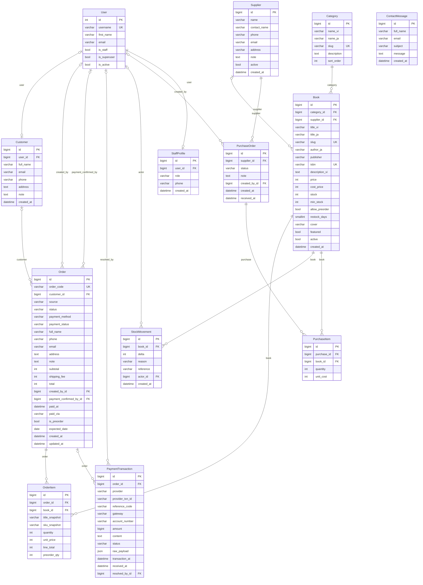

# ERD Hép Bookstore

Sinh tự động từ `shop/models.py`. Chạy lại: `python3 docs/gen_erd.py`.

Ký hiệu: PK khoá chính, FK khoá ngoại, UK duy nhất. `||--o{` một-nhiều, `|o--o{` một-nhiều phía cha có thể rỗng, `||--o|` một-một.

## Mô tả bảng

### User: Tài khoản đăng nhập (Django auth)

| Trường | Kiểu | Khoá | Ghi chú |
| --- | --- | --- | --- |
| id | int | PK | ID |
| username | varchar | UK | Tên đăng nhập |
| first_name | varchar |  | Tên |
| email | varchar |  | địa chỉ email |
| is_staff | bool |  | tình trạng nhân viên |
| is_superuser | bool |  | trạng thái superuser |
| is_active | bool |  | Kích hoạt |

### Category: Danh mục sách

| Trường | Kiểu | Khoá | Ghi chú |
| --- | --- | --- | --- |
| id | bigint | PK | ID |
| name_vi | varchar |  | Tên danh mục |
| name_ja | varchar |  | Tên tiếng Nhật |
| slug | varchar | UK |  |
| description | text |  |  |
| sort_order | int |  |  |

### Supplier: Nhà cung cấp

| Trường | Kiểu | Khoá | Ghi chú |
| --- | --- | --- | --- |
| id | bigint | PK | ID |
| name | varchar |  | Tên nguồn cung |
| contact_name | varchar |  |  |
| phone | varchar |  |  |
| email | varchar |  |  |
| address | varchar |  |  |
| note | text |  |  |
| active | bool |  |  |
| created_at | datetime |  |  |

### Book: Sách

| Trường | Kiểu | Khoá | Ghi chú |
| --- | --- | --- | --- |
| id | bigint | PK | ID |
| category_id | bigint | FK | tham chiếu Category |
| supplier_id | bigint | FK | tham chiếu Supplier, có thể rỗng |
| title_vi | varchar |  | Tên sách tiếng Việt |
| title_ja | varchar |  | Tên tiếng Nhật |
| slug | varchar | UK |  |
| author_ja | varchar |  | Tác giả |
| publisher | varchar |  |  |
| isbn | varchar | UK | ISBN / SKU |
| description_vi | text |  | Mô tả |
| price | int |  | Giá (VNĐ) |
| cost_price | int |  | Giá nhập (VNĐ) |
| stock | int |  | Tồn kho |
| min_stock | int |  | Ngưỡng cảnh báo |
| allow_preorder | bool |  | Nhận đặt trước khi hết hàng |
| restock_days | smallint |  | Số ngày dự kiến có hàng |
| cover | varchar |  | Tên ảnh trong static/img |
| featured | bool |  |  |
| active | bool |  |  |
| created_at | datetime |  |  |

### Customer: Khách hàng

| Trường | Kiểu | Khoá | Ghi chú |
| --- | --- | --- | --- |
| id | bigint | PK | ID |
| user_id | bigint | FK | tham chiếu User, có thể rỗng |
| full_name | varchar |  |  |
| email | varchar |  |  |
| phone | varchar |  |  |
| address | text |  |  |
| note | text |  |  |
| created_at | datetime |  |  |

### Order: Đơn hàng (web, Facebook, Instagram, POS)

| Trường | Kiểu | Khoá | Ghi chú |
| --- | --- | --- | --- |
| id | bigint | PK | ID |
| order_code | varchar | UK |  |
| customer_id | bigint | FK | tham chiếu Customer, có thể rỗng |
| source | varchar |  | web, facebook, instagram, pos |
| status | varchar |  | new, confirmed, packing, shipped, completed, cancelled |
| payment_method | varchar |  | bank, cod, cash |
| payment_status | varchar |  | unpaid, paid, refunded |
| full_name | varchar |  |  |
| phone | varchar |  |  |
| email | varchar |  |  |
| address | text |  |  |
| note | text |  |  |
| subtotal | int |  |  |
| shipping_fee | int |  |  |
| total | int |  |  |
| created_by_id | bigint | FK | tham chiếu User, có thể rỗng |
| payment_confirmed_by_id | bigint | FK | tham chiếu User, có thể rỗng |
| paid_at | datetime |  |  |
| paid_via | varchar |  | Cách xác nhận thu tiền; manual, sepay, pos_cash |
| is_preorder | bool |  | Đơn đặt trước |
| expected_date | date |  | Ngày dự kiến có hàng |
| created_at | datetime |  |  |
| updated_at | datetime |  |  |

### OrderItem: Dòng đơn

| Trường | Kiểu | Khoá | Ghi chú |
| --- | --- | --- | --- |
| id | bigint | PK | ID |
| order_id | bigint | FK | tham chiếu Order |
| book_id | bigint | FK | tham chiếu Book |
| title_snapshot | varchar |  |  |
| sku_snapshot | varchar |  |  |
| quantity | int |  |  |
| unit_price | int |  |  |
| line_total | int |  |  |
| preorder_qty | int |  | Số cuốn chờ hàng về |

### PaymentTransaction: Giao dịch tiền vào (SePay)

| Trường | Kiểu | Khoá | Ghi chú |
| --- | --- | --- | --- |
| id | bigint | PK | ID |
| order_id | bigint | FK | tham chiếu Order, có thể rỗng |
| provider | varchar |  | sepay |
| provider_txn_id | varchar |  | Mã giao dịch SePay |
| reference_code | varchar |  | Mã tham chiếu ngân hàng |
| gateway | varchar |  | Ngân hàng |
| account_number | varchar |  |  |
| amount | bigint |  | Số tiền |
| content | text |  | Nội dung chuyển khoản |
| status | varchar |  | matched, unmatched, amount_mismatch, duplicate_paid, multiple_orders |
| raw_payload | json |  |  |
| transaction_at | datetime |  | Thời điểm ngân hàng ghi nhận |
| received_at | datetime |  |  |
| resolved_by_id | bigint | FK | tham chiếu User, có thể rỗng |

### StockMovement: Nhật ký biến động kho

| Trường | Kiểu | Khoá | Ghi chú |
| --- | --- | --- | --- |
| id | bigint | PK | ID |
| book_id | bigint | FK | tham chiếu Book |
| delta | int |  |  |
| reason | varchar |  |  |
| reference | varchar |  |  |
| actor_id | bigint | FK | tham chiếu User, có thể rỗng |
| created_at | datetime |  |  |

### PurchaseOrder: Phiếu nhập hàng

| Trường | Kiểu | Khoá | Ghi chú |
| --- | --- | --- | --- |
| id | bigint | PK | ID |
| supplier_id | bigint | FK | tham chiếu Supplier |
| status | varchar |  | draft, received |
| note | text |  |  |
| created_by_id | bigint | FK | tham chiếu User, có thể rỗng |
| created_at | datetime |  |  |
| received_at | datetime |  |  |

### PurchaseItem: Dòng phiếu nhập

| Trường | Kiểu | Khoá | Ghi chú |
| --- | --- | --- | --- |
| id | bigint | PK | ID |
| purchase_id | bigint | FK | tham chiếu PurchaseOrder |
| book_id | bigint | FK | tham chiếu Book |
| quantity | int |  |  |
| unit_cost | int |  |  |

### StaffProfile: Hồ sơ nhân viên, vai trò

| Trường | Kiểu | Khoá | Ghi chú |
| --- | --- | --- | --- |
| id | bigint | PK | ID |
| user_id | bigint | FK | tham chiếu User |
| role | varchar |  | Vai trò; manager, sales, warehouse |
| phone | varchar |  |  |
| created_at | datetime |  |  |

### ContactMessage: Lời nhắn liên hệ

| Trường | Kiểu | Khoá | Ghi chú |
| --- | --- | --- | --- |
| id | bigint | PK | ID |
| full_name | varchar |  |  |
| email | varchar |  |  |
| subject | varchar |  |  |
| message | text |  |  |
| created_at | datetime |  |  |

## Ràng buộc nghiệp vụ

- `PaymentTransaction (provider, provider_txn_id)` duy nhất: SePay gửi lại không ghi trùng.
- `Order.order_code` duy nhất, dạng `HEP` + ngày + 8 ký tự, là nội dung chuyển khoản để khớp tiền.
- Tồn kho `Book.stock` chỉ đổi qua service, mỗi lần đổi ghi một `StockMovement`.
- `StaffProfile.role`: manager (toàn quyền), sales (đơn, POS, tiền vào), warehouse (sách, kho, nhập hàng).
- Đặt trước: sách hết hàng có `Book.allow_preorder` vẫn nhận đơn web/Facebook/Instagram. Phần thiếu ghi vào `OrderItem.preorder_qty`, `Order.is_preorder` bật và `Order.expected_date` = ngày đặt + `Book.restock_days` lớn nhất. Kho chỉ trừ phần thiếu khi đơn chuyển sang đóng gói.
