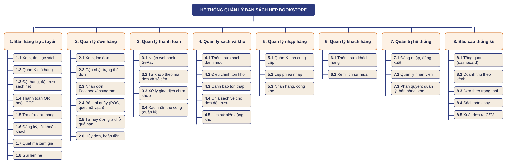
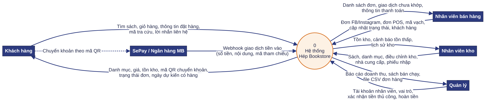
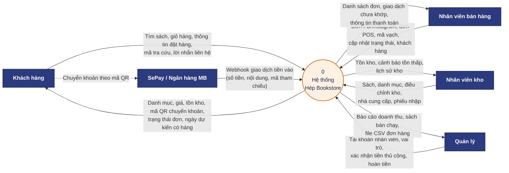
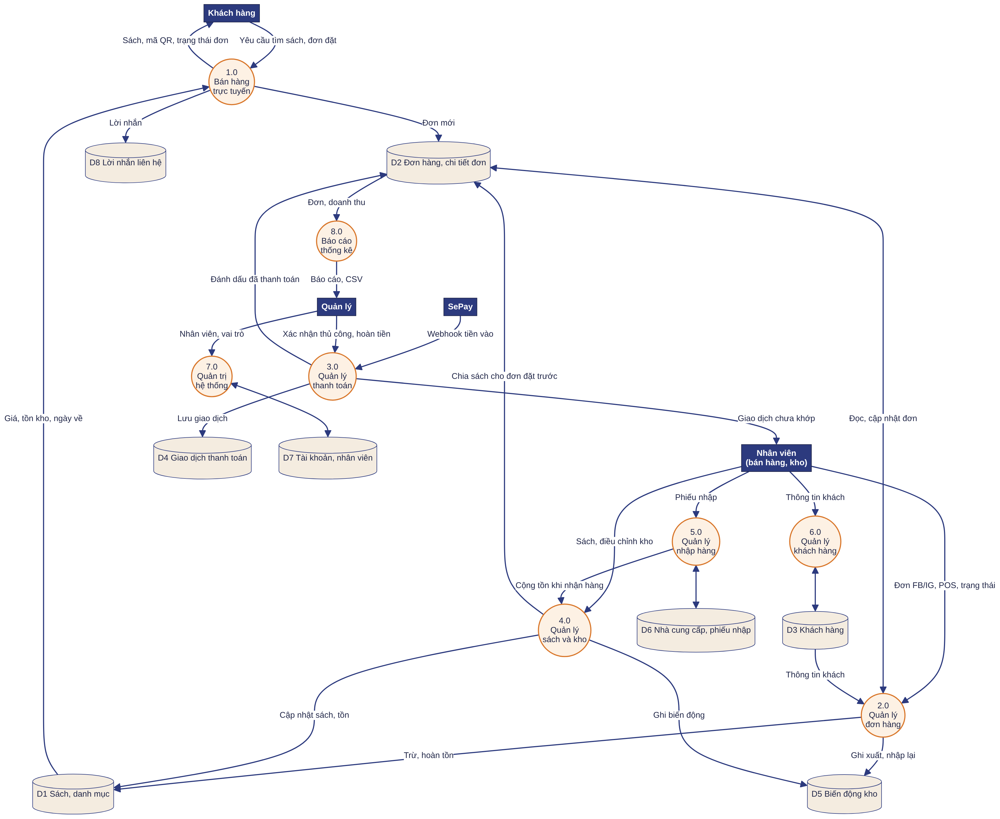
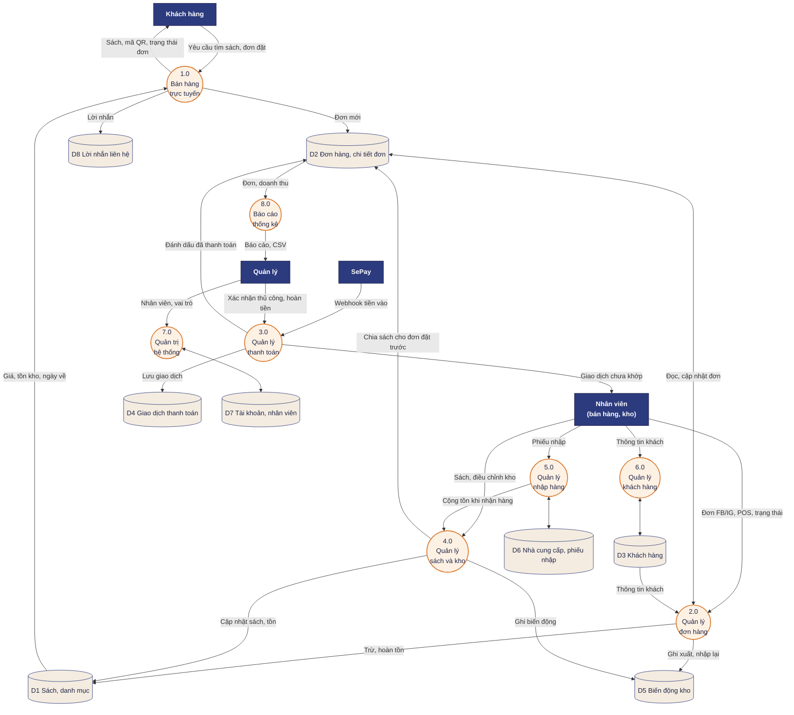
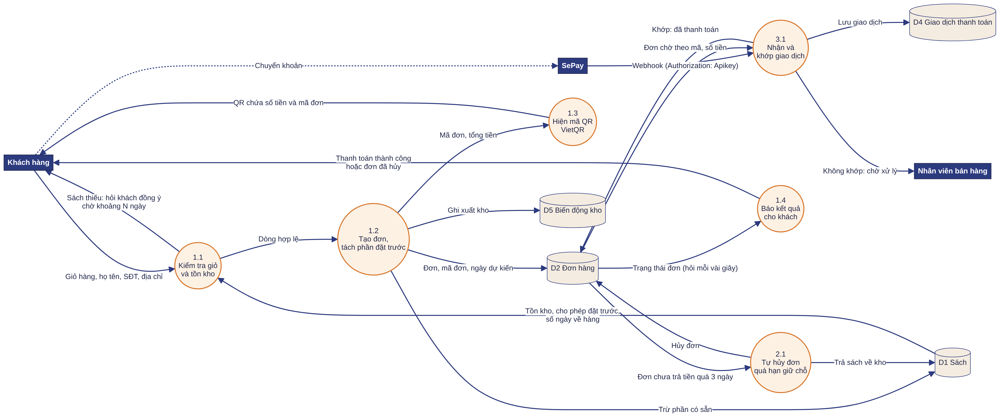
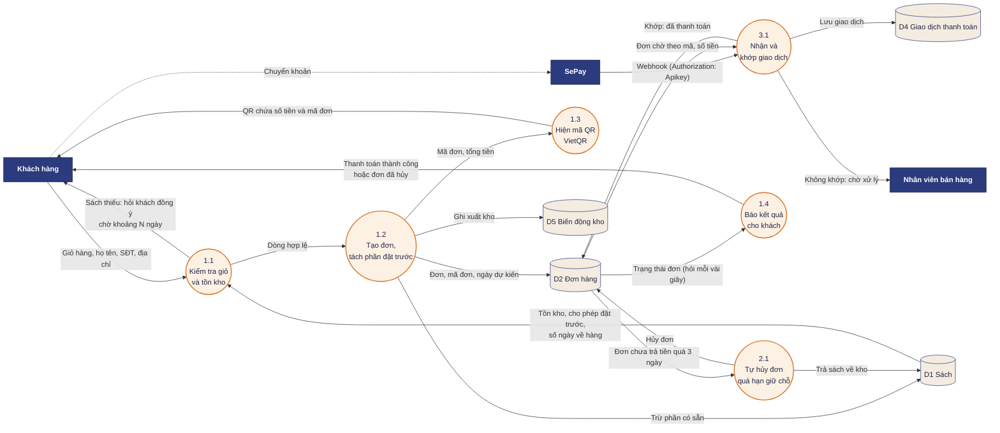
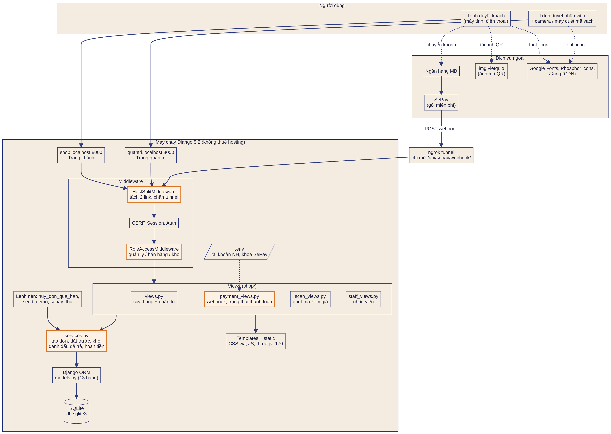
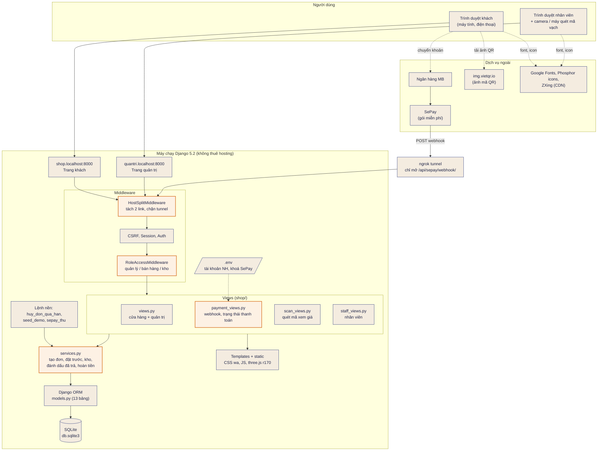

# Sơ đồ phân tích hệ thống Hép Bookstore

BFD, DFD và kiến trúc hệ thống, dựng theo mã nguồn hiện tại. Ảnh PNG nằm trong `docs/diagrams/`.

## Sơ đồ phân rã chức năng (BFD)

8 nhóm chức năng chính, mỗi nhóm tách thành các chức năng con. Nhóm 1 dành cho khách; nhóm 2 đến 8 nằm ở trang quản trị và chỉ mở theo vai trò: bán hàng (2, 3, 6), kho (4, 5), quản lý (tất cả, riêng 3.4, 2.6 hoàn tiền, 7 và 8 chỉ quản lý).

## DFD mức ngữ cảnh (mức 0)

Toàn bộ hệ thống là một tiến trình. 5 tác nhân ngoài trao đổi dữ liệu với hệ thống. Khách chuyển khoản trực tiếp cho ngân hàng (nét đứt), hệ thống chỉ biết tiền vào qua webhook của SePay.

## DFD mức đỉnh (mức 1)

8 tiến trình ứng với 8 chức năng BFD, 8 kho dữ liệu ứng với các bảng trong ERD: D1 Book, Category; D2 Order, OrderItem; D3 Customer; D4 PaymentTransaction; D5 StockMovement; D6 Supplier, PurchaseOrder, PurchaseItem; D7 User, StaffProfile; D8 ContactMessage.

## DFD mức dưới đỉnh (mức 2): đặt hàng và thanh toán QR

Phân rã luồng quan trọng nhất: khách đặt hàng, trả tiền bằng QR, đơn tự chuyển sang đã thanh toán. Đơn chuyển khoản không trả tiền sau 3 ngày bị hủy và trả sách về kho.

## Kiến trúc hệ thống (System Architecture)

Ứng dụng Django một khối chạy trên máy cửa hàng, không thuê hosting. Hai tên miền trên cùng một server được tách bằng middleware. Chỉ đường dẫn webhook được mở ra Internet qua ngrok để SePay gọi vào. Luồng nghiệp vụ dồn vào services.py; views chỉ nhận yêu cầu và hiển thị.

